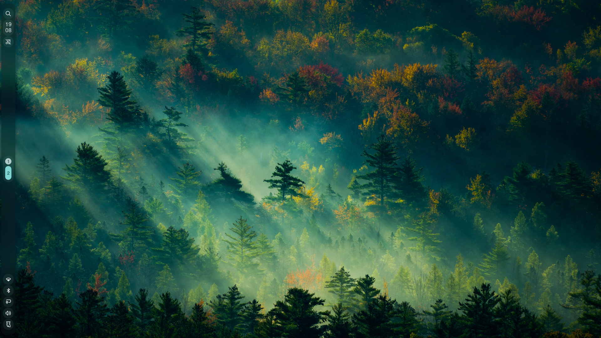
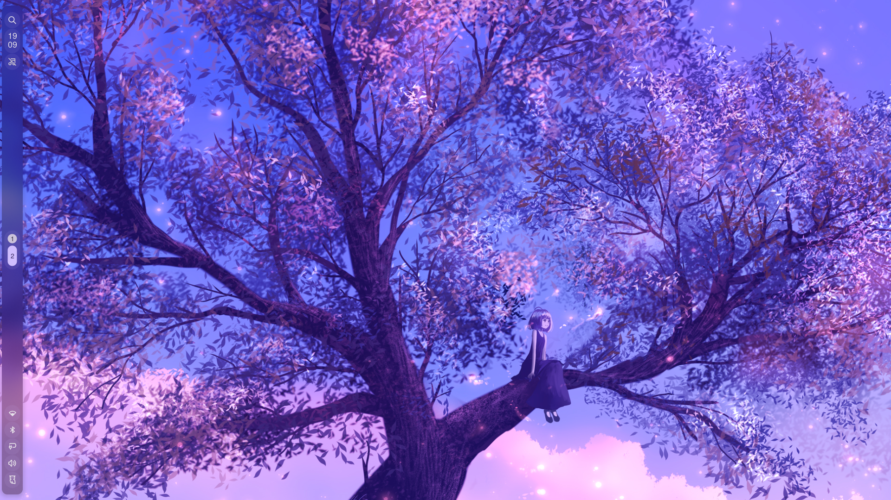
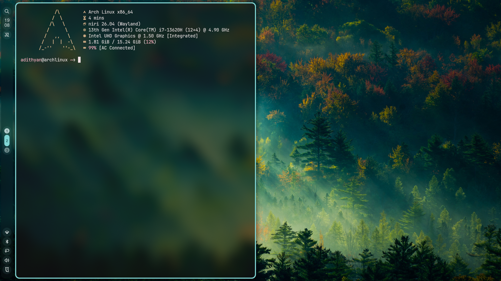

# My-dots

A Niri and Noctalia v5 desktop setup with a left-side bar, wallpaper-based colors, Kitty, Fish, Fastfetch, a dark cursor, and an optional Pixie SDDM login theme. Wallpaper images are not included.

## Screenshots

### Desktop



### Purple wallpaper



### Kitty terminal



The screenshots show example wallpapers; wallpaper files are not included.

## Requirements

- A working Niri Wayland session and Noctalia v5 (developed with Niri 26.04 and Noctalia 5.4.1).
- Kitty, Python 3, systemd user services, and a graphical session.
- Recommended: Fish, Fastfetch, JetBrains Mono Nerd Font, Nautilus, brightnessctl, playerctl, wireplumber, swayidle, xwayland-satellite, fuzzel and a Polkit authentication agent. Zen Browser is bound to Mod+B. The config starts the KDE Polkit agent using its Arch path; adjust it for your distro.
- On Arch, for example: `sudo pacman -S niri noctalia kitty fish fastfetch ttf-jetbrains-mono-nerd nautilus brightnessctl playerctl wireplumber swayidle xwayland-satellite fuzzel polkit-kde-agent`. Package availability and names vary by distribution.

## Install

Run as your regular user from an active Niri session:

```bash
./install.sh
```

The script validates the staged Niri and Noctalia configs, saves existing files under `~/.local/state/my-dots-backups/`, and installs the configuration, scripts, services and cursor theme. It enables a daily user-configuration backup timer and the sleep-lock helper if swayidle is installed. The daily snapshots exclude wallpapers, accumulate under `~/.local/state/my-dots-backups/`, and are stored on the same disk. Copy them elsewhere for disk-failure protection. It creates `~/Pictures/noctalia-wallpapers` and `~/Pictures/Screenshots`.

Add your own wallpaper images to `~/Pictures/noctalia-wallpapers`, then press **Mod+Shift+W** to choose one. Noctalia's Niri template generates border colors from the wallpaper; the backdrop appears in overview. Noctalia's existing GUI-managed state may override the shipped TOML settings. If settings look different, inspect `~/.local/state/noctalia/settings.toml` and use the Noctalia settings UI. The installer does not overwrite that state.

Kitty uses JetBrains Mono Nerd Font and starts Fish when available, otherwise Bash. Fish shows Fastfetch in Kitty if installed. The icon theme is a converted version of the free Windows 11 Cursors Concept v2 by Jepri Creations; see `icons/ATTRIBUTION.md`.

## Keybindings

| Shortcut | Action |
| --- | --- |
| Mod+Return | Kitty terminal |
| Mod+Space | Noctalia launcher |
| Mod+E | Nautilus |
| Mod+I | Noctalia settings |
| Mod+V | Clipboard history |
| Mod+Shift+W | Wallpaper picker |
| Mod+Shift+S | Select an area for a screenshot |
| Mod+L | Lock |
| Mod+K | Toggle Awake mode |
| Mod+Ctrl+V | Toggle floating window |

Awake mode inhibits idle and sleep and displays a notification. Manual lid and power actions can still suspend. The user service stops with the graphical session. Mod+Right and Mod+Up navigate windows in place of the original Mod+L and Mod+K.

## Weekly update reminder

On Arch systems with `pacman`, `yay` and `notify-send`, the installer enables a reminder that checks at login and hourly. If no successful update has been recorded in seven days, it offers a notification. Choosing Review and install opens Kitty and runs `sudo pacman -Syu` followed by `yay -Syu`; both can request confirmation and a password. Dismissed reminders can return the next day. Only updates run through this helper are recorded. The reminder does not start installation without your choice.

To disable the reminder, run `systemctl --user disable --now weekly-update-reminder.timer` and `systemctl --user disable weekly-update-reminder.service`.

## Optional system settings

**SDDM:** `sudo ./install-system.sh --sddm` installs Pixie and selects it for the next login. Install Qt6 declarative and SVG modules first. No wallpaper is bundled; the theme starts with a solid background. Set a readable system-wide image path in `/usr/share/sddm/themes/pixie/theme.conf` if desired. Preview with `sddm-greeter-qt6 --test-mode --theme /usr/share/sddm/themes/pixie` before logging out. System files are backed up under `/var/backups/`.

**Power and lid:** `sudo ./install-system.sh --power` sets power-button and lid actions to suspend, including when docked. Review the file in `system/logind/` first. Noctalia and the supplied swayidle helper request a lock before sleep. Actual hardware behavior and other inhibitors vary; confirm on your machine.

**Laptop refresh rate:** The supplied `laptop-refresh-rate` script is specific to the original laptop: eDP-1, 1920×1080, 60.061 Hz on battery and 144.063 Hz on AC. It is installed but deliberately not enabled. Edit it for your panel and verify modes with `niri msg outputs`, then run `systemctl --user enable --now laptop-refresh-rate.service` if appropriate.

## Undo

Backups contain only the items replaced by the installer, not a complete home directory. Restore desired files from the timestamped backup to their original paths, then run `systemctl --user daemon-reload`. Disable `lock-before-sleep.service` or `laptop-refresh-rate.service` if you no longer want them. For optional system changes, restore the relevant files from `/var/backups/my-dots-*` with administrator access. Log out and back in when needed.

The original Noctalia v4 inspiration is [niri-noctalia-dotfiles](https://github.com/noclueatthis/niri-noctalia-dotfiles). Pixie SDDM is by [xCaptaiN09](https://github.com/xCaptaiN09/pixie-sddm), with its MIT license included. Configuration APIs can change across versions; inspect and validate after upgrading.
